# Marey

An open-source desktop control panel for Leap Motion and Ultraleap hand tracking devices: service and
device status, a live 3D hand view, infrared camera images, tracking settings, logs and diagnostics.

Marey talks to the Ultraleap tracking service through LeapC. It does not include the service or
LeapC, and it does not track hands by itself. macOS on Apple silicon is the first supported platform.

> **Known issue:** with Ultraleap Hand Tracking 6.2.0, an original Leap Motion Controller has stopped
> sending frames during our tests, for every client of the service. See
> [Troubleshooting](#troubleshooting).

## Prerequisites

- Rust (stable) and the Xcode Command Line Tools, which provide libclang
- Node.js and pnpm
- Ultraleap Hand Tracking, which provides the service and the `LeapC.h` used at build time
- [Task](https://taskfile.dev), which runs the project's operations

On macOS, install Task with Homebrew:

```bash
brew install go-task
```

See the [Task installation guide](https://taskfile.dev/installation/) for other systems.

## Setup and running

Run the app in development mode. Tasks that need the JavaScript dependencies install them first:

```bash
task dev
```

### Mock mode

Run the app with synthetic hands and images, with no device or service:

```bash
task dev:mock
```

A banner stays visible while it is on. Synthetic data never appears outside this mode.

To build without the Ultraleap SDK at all, which leaves only mock mode, start the frontend and the
backend separately:

```bash
pnpm dev
```

```bash
MAREY_MOCK=1 cargo run -p marey --no-default-features
```

### Configuration

| Variable           | Purpose                                                          |
| ------------------ | ---------------------------------------------------------------- |
| `LEAPSDK_LIB_PATH` | Directory holding the LeapC library, instead of the default path |
| `MAREY_MOCK`       | `1` turns on simulation; any other value leaves it off           |

## Closing and quitting

Closing the window keeps Marey running in the tray. Quit it from the tray menu or the app menu.

## Tasks

The operations are defined in [Taskfile.yml](Taskfile.yml). These are the basic ones:

| Command            | What it does                                                       |
| ------------------ | ------------------------------------------------------------------ |
| `task dev`         | Runs the desktop app in development mode                           |
| `task dev:mock`    | Runs it with simulated hands and images, with no device needed     |
| `task dev:web`     | Runs only the frontend dev server, without the desktop shell       |
| `task build`       | Builds the release app and installers                              |
| `task build:debug` | Builds the app with debug symbols and devtools                     |
| `task check`       | Runs the type check, formatting checks, linters and tests          |
| `task test`        | Runs the Rust and frontend tests, which need no device             |
| `task lint`        | Runs Clippy, with warnings as errors, and ESLint                   |
| `task fmt`         | Formats Rust and the frontend                                      |
| `task types`       | Regenerates the TypeScript types from the Rust DTOs                |
| `task icon`        | Generates the app icons from `src/assets/brand/marey-app-icon.svg` |
| `task clean`       | Removes the frontend bundle and the Rust `target` directory        |

To see every task, run:

```bash
task --list
```

`task dev`, `task dev:mock`, `task build` and `task build:debug` pass anything after `--` to the Tauri
CLI. For example, this builds only the macOS app bundle:

```bash
task build -- --bundles app
```

## Development

Run `task check` before committing. None of its checks need a device. After changing a DTO in
`src-tauri/src/models`, run `task types` to regenerate the TypeScript types.

See [ARCHITECTURE.md](docs/ARCHITECTURE.md), [ROADMAP.md](docs/ROADMAP.md) and the
[decision records](docs/adr).

## Troubleshooting

**"Ultraleap tracking software not found"**: Marey could not load LeapC. Install the software or set
`LEAPSDK_LIB_PATH`. The exact path it tried is shown in the message.

**Build fails with "LeapC.h was not found"**: install the software, set `LEAPSDK_LIB_PATH`, or build
with `--no-default-features`.

**"The tracking service is not running"**: start Ultraleap Hand Tracking. Marey reconnects by itself.

**"Device detected, but no frames are arriving"**: unplug the device and plug it back in, which
restored the stream in our tests. The Ultraleap Control Panel stops updating at the same time, and may
keep showing its last frame rate, so the stall is not specific to Marey. Its cause is still unknown.
Also check that no app has paused tracking, because pausing applies to the whole service.

**"No status flags set" while tracking works**: an original Leap Motion Controller reported status
`0x0` even while streaming at about 115 fps, so Marey shows the measured tracking rate as well.

**Camera view stays on "Waiting for images"**: images need a device that is sending frames. Settings
shows a note when the service does not report a requested option as on.

## Licence and third parties

Marey's own licence has not been chosen yet. Use of the Ultraleap software and SDK is governed by
Ultraleap's licence, shipped as `LeapSDK/LICENSE.md` in its installation. This project is not
affiliated with or endorsed by Ultraleap.
