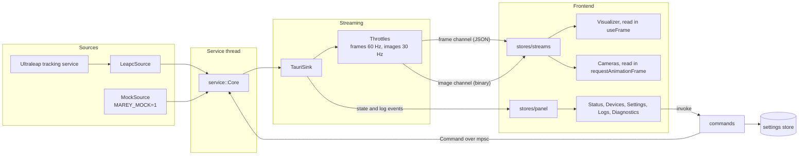

# Architecture

Marey is a Tauri v2 desktop app. A Rust backend owns the connection to the tracking source, and a
React frontend renders its state and streams.

## Data flow

## Backend layout

| Path                              | Responsibility                                                     |
| --------------------------------- | ------------------------------------------------------------------ |
| `crates/leapc-sys`                | Bindings generated from the installed `LeapC.h`, loaded at runtime |
| `crates/leapc`                    | Thin safe wrapper over those bindings                              |
| `src-tauri/src/leap`              | `TrackingSource` trait and the mapping of LeapC values             |
| `src-tauri/src/leap/service`      | State machine (`machine`), its thread (`thread`) and log history   |
| `src-tauri/src/leap/mock`         | Simulated device, with its hands and camera images                 |
| `src-tauri/src/leap/leapc_source` | The LeapC source and the conversions from its raw structs          |
| `src-tauri/src/models`            | DTOs shared with the frontend; TypeScript is generated from them   |
| `src-tauri/src/streaming`         | Throttling, channels and the binary image format                   |
| `src-tauri/src/settings`          | Preference persistence with the store plugin                       |
| `src-tauri/src/commands`          | Thin Tauri command handlers                                        |
| `src-tauri/src/window.rs`         | Behaviour of the main window                                       |

The `leap`, `models` and `streaming::throttle` modules do not depend on Tauri, so a CLI or an OSC
bridge can reuse them. New data sources implement `TrackingSource`, and new outputs implement
`EventSink`.

## Threading

All LeapC calls run on the `marey-tracking` thread, which owns the connection. Commands reach it
through a channel and are served between polls, which last at most 20 ms. Commands run on Tauri's
thread pool, so waiting for a reply never blocks the main thread.

## Connection handling

- A missing library is `sdkMissing`, retried every 5 seconds.
- `refresh`, about once a second, reads the connection status, which gives `serviceNotRunning` and
  `connecting`, and re-reads each device's status.
- LeapC reconnects by itself, so the source survives service restarts. A lost connection clears the
  device list, and devices are activated again when they reappear.
- Settings are applied again every time a device is activated.

## Streams

Tracking frames are sent as JSON through a channel. Images use a separate channel with a raw binary
message: four little-endian `u32` values (width, height, bytes per pixel, low bits of the frame id)
followed by the left and right planes. Throttling drops data instead of queueing it, and it runs
before the image copy.

The frontend stores the latest stream data outside React in `stores/streams.ts`. The 3D scene and
the camera canvases read it from their own animation loops, so frames cause no re-renders. Instanced
meshes are updated in place.

## Frontend layout

| Path                   | Responsibility                                                    |
| ---------------------- | ----------------------------------------------------------------- |
| `src/app`              | The shell: sidebar, footer and the registry of views (`views.ts`) |
| `src/features/*`       | One folder per view, with its components, hooks and pure logic    |
| `src/components/ui`    | shadcn/ui components, not edited for app-specific needs           |
| `src/components/*.tsx` | Shared building blocks composed from them                         |
| `src/hooks`, `src/lib` | Shared hooks and helpers; `src/lib/tauri` wraps the backend       |
| `src/i18n`             | Translations and the supported languages                          |
| `src/stores`           | App state (`panel`) and the latest stream data (`streams`)        |
| `src/types/generated`  | Types generated from Rust (`task types`), not edited by hand      |

## Frontend rules

- The brand theme lives in `src/styles.css`. The 3D scene cannot use it, so its colors are in
  `src/features/visualizer/theme.ts`.
- Only `src/lib/tauri` may import `@tauri-apps/*`. ESLint enforces this.
- Code outside the current folder is imported through the `@` alias. ESLint enforces this as well.
- Logic that needs no DOM has unit tests next to it (`*.test.ts`), which run with `task test`.

## Languages

English is the default, and Spanish is also available. Every string shown to the user lives in
`src/i18n/locales`, and `t` only accepts keys that exist in `en.json`. A test checks that all languages
have the same keys and placeholders. To add a language, add its file and list it in `languages.ts`
and `src/i18n/index.ts`.

The choice is a preference of the UI, so it is kept in `localStorage` and does not go through
`Settings`, which are applied to the device. The frontend sends the tray menu its translated text,
so all translations stay in one place.

Three things stay in English on purpose: the diagnostics report and the log lines, which go into bug
reports, and errors that come from the backend, which include text from LeapC.

## App icon

`src/assets/brand/marey-app-icon.svg` is the source of everything in `src-tauri/icons` except the tray
icons, and `task icon` regenerates them. The solid M is what gets centred. The trails extend to its
left and do not take part in the centring.

## Mock mode

`MAREY_MOCK=1` is the only way to get synthetic data. The link status carries a `mock` flag, and the
UI shows a permanent banner while it is set.
