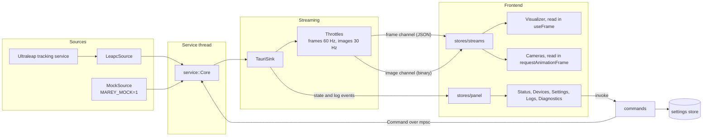

# Architecture

Marey is a Tauri v2 desktop app. A Rust backend owns the connection to the tracking source, and a
React frontend renders its state and streams.

## Data flow

## Backend layout

| Path                      | Responsibility                                                         |
| ------------------------- | ---------------------------------------------------------------------- |
| `crates/leapc-sys`        | Bindings generated from the installed `LeapC.h`, loaded at runtime     |
| `crates/leapc`            | Thin safe wrapper over those bindings                                  |
| `src-tauri/src/leap`      | `TrackingSource` trait, sources, mapping and the service state machine |
| `src-tauri/src/models`    | DTOs shared with the frontend; TypeScript is generated from them       |
| `src-tauri/src/streaming` | Throttling, channels and the binary image format                       |
| `src-tauri/src/settings`  | Preference persistence with the store plugin                           |
| `src-tauri/src/commands`  | Thin Tauri command handlers                                            |

The `leap`, `models` and `streaming::throttle` modules do not depend on Tauri, so a CLI or an OSC
bridge can reuse them. New data sources implement `TrackingSource`, and new outputs implement
`EventSink`.

## Threading

All LeapC calls run on the `marey-tracking` thread, which owns the connection. Commands reach it
through a channel and are served between polls, which last at most 20 ms. Commands run on Tauri's
thread pool, so waiting for a reply never blocks the main thread.

## Connection handling

- A missing library is `sdkMissing`, retried every 5 seconds.
- `refresh`, about once a second, reads the connection status, which gives `serviceNotRunning` and
  `connecting`, and re-reads each device's status.
- LeapC reconnects by itself, so the source survives service restarts. A lost connection clears the
  device list, and devices are activated again when they reappear.
- Settings are applied again every time a device is activated.

## Streams

Tracking frames are sent as JSON through a channel. Images use a separate channel with a raw binary
message: four little-endian `u32` values (width, height, bytes per pixel, low bits of the frame id)
followed by the left and right planes. Throttling drops data instead of queueing it, and it runs
before the image copy.

The frontend stores the latest stream data outside React in `stores/streams.ts`. The 3D scene and
the camera canvases read it from their own animation loops, so frames cause no re-renders. Instanced
meshes are updated in place.

## Frontend rules

- Only `src/lib/tauri` may import `@tauri-apps/*`. ESLint enforces this.
- Types in `src/types/generated` come from Rust (`task types`) and are not edited by hand.

## Mock mode

`MAREY_MOCK=1` is the only way to get synthetic data. The link status carries a `mock` flag, and the
UI shows a permanent banner while it is set.
